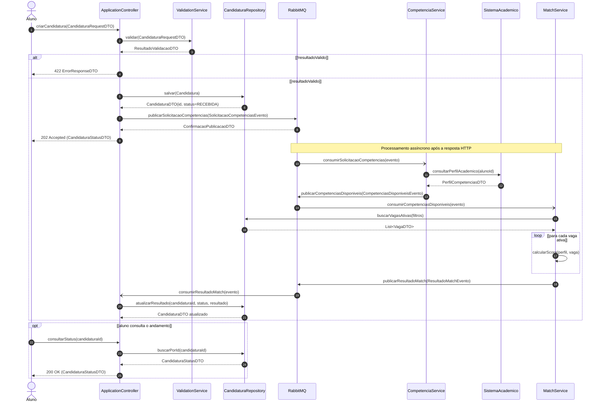
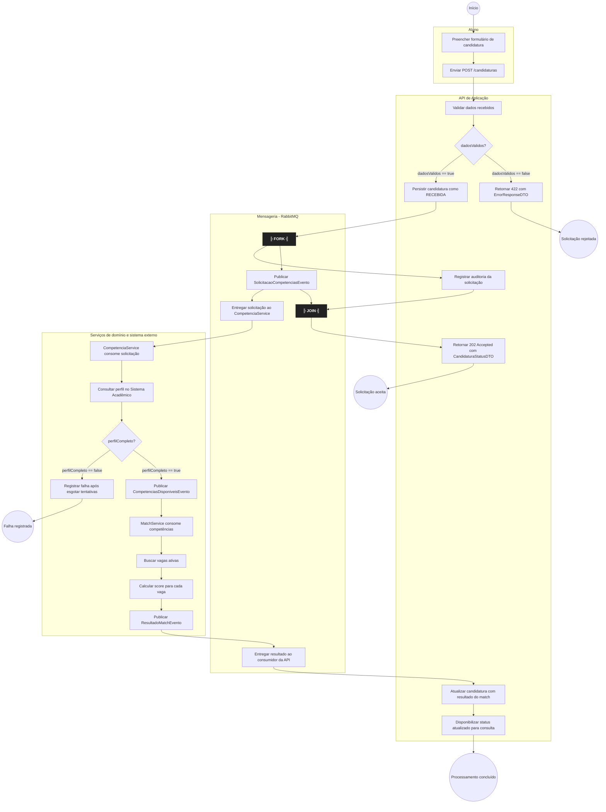
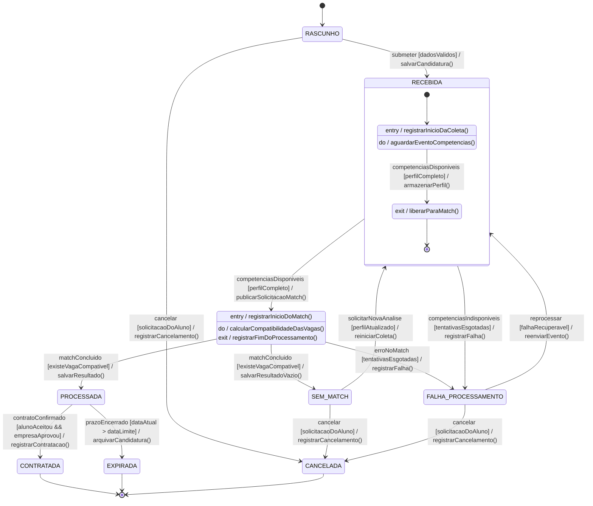
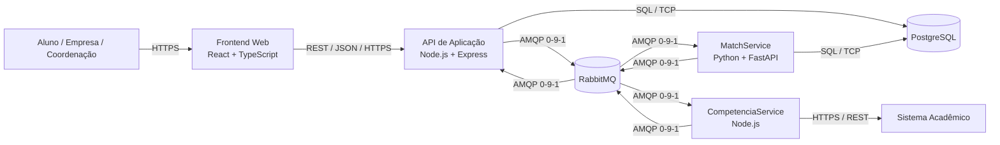

# APS 3 — Dossiê de Arquitetura Viva
## Gestão de Estágios UniSenai — API de Candidatura e Match de Competências

**Unidade Curricular:** Modelagem de Software  
**Curso:** Engenharia de Software — 4º Período — UniSenai  
**Docente:** Prof. Sidney L. da Silva  
**Modalidade:** Avaliação Prática Supervisionada — individual

---

## 1. Escopo da funcionalidade

A funcionalidade crítica modelada é o **processamento de uma candidatura e a identificação de vagas compatíveis com o perfil acadêmico do aluno**.

A API de Aplicação recebe a candidatura, valida os dados, persiste a entidade e inicia o processamento assíncrono. O `CompetenciaService` consulta o perfil acadêmico no Sistema Acadêmico. Em seguida, o `MatchService` compara as competências do aluno com os requisitos das vagas ativas. Ao final, a API registra o resultado para que o aluno consulte o andamento.

A entidade principal é `Candidatura`. Seu ciclo de vida é representado no diagrama de estados. A arquitetura deste dossiê é uma **proposta de solução** para a funcionalidade, não uma afirmação de que todos os serviços e tecnologias já estejam implementados no projeto.

### Fluxo de negócio resumido

1. O aluno envia `POST /candidaturas`.
2. A API valida os dados e persiste a candidatura como `RECEBIDA`.
3. A API publica `SolicitacaoCompetenciasEvento` no RabbitMQ e responde `202 Accepted`.
4. O serviço de competências consulta o Sistema Acadêmico e publica `CompetenciasDisponiveisEvento`.
5. O Match Service calcula a compatibilidade com as vagas e publica `ResultadoMatchEvento`.
6. A API consome o resultado e atualiza a candidatura para `PROCESSADA` ou `SEM_MATCH`.
7. O aluno consulta o estado atualizado em `GET /candidaturas/{id}`.

A resposta `202 Accepted` é intencional: ela confirma que a solicitação foi aceita para processamento, não que o match já terminou.

---

## 2. Contratos públicos e DTOs

Para manter a consistência entre as mensagens do diagrama de sequência e as operações dos participantes, são definidos os seguintes contratos conceituais. Os nomes representam operações públicas propostas para cada componente.

| Participante | Operações públicas utilizadas | DTO / evento principal |
|---|---|---|
| `ApplicationController` | `criarCandidatura()`, `consumirResultadoMatch()`, `consultarStatus()` | `CandidaturaRequestDTO`, `CandidaturaStatusDTO`, `ErrorResponseDTO` |
| `ValidationService` | `validar()` | `ResultadoValidacaoDTO` |
| `CandidaturaRepository` | `salvar()`, `atualizarResultado()`, `buscarPorId()`, `buscarVagasAtivas()` | `CandidaturaDTO`, `VagaDTO`, `CandidaturaStatusDTO` |
| `RabbitMQ` (adaptador de mensageria) | `publicarSolicitacaoCompetencias()`, `publicarCompetenciasDisponiveis()`, `publicarResultadoMatch()`; roteia eventos para os consumidores inscritos | `SolicitacaoCompetenciasEvento`, `CompetenciasDisponiveisEvento`, `ResultadoMatchEvento` |
| `CompetenciaService` | `consumirSolicitacaoCompetencias()` | `PerfilCompetenciasDTO` |
| `SistemaAcademico` | `consultarPerfilAcademico()` | `PerfilCompetenciasDTO` |
| `MatchService` | `consumirCompetenciasDisponiveis()`, `calcularScore()` | `VagaDTO`, `ResultadoMatchEvento` |

**Regra de integração:** cada evento deve conter `eventId`, `candidaturaId`, `alunoId`, `correlationId` e `occurredAt`. O conteúdo específico varia conforme o evento. Os consumidores verificam o identificador do evento e o estado atual da candidatura para evitar processamento duplicado.

---

## 3. Artefato 1 — Diagrama de Sequência (UML / Mermaid)

O diagrama mostra a validação síncrona da requisição e a continuação assíncrona do pipeline por RabbitMQ. A API responde `202 Accepted` após persistir a candidatura e publicar a solicitação; o aluno consulta o resultado posteriormente.



Código-fonte: [`docs/diagrams/sequencia.mmd`](docs/diagrams/sequencia.mmd).

---

## 4. Artefato 2 — Diagrama de Atividades com Raias (UML / Mermaid)

As raias separam as responsabilidades do aluno, da API, do RabbitMQ e dos serviços. Após persistir a candidatura, o fork divide duas atividades independentes: publicar a solicitação de competências e registrar a auditoria. O join aguarda as duas atividades antes de a API responder `202 Accepted`. A coleta de competências e o match continuam de forma assíncrona, sem executar o algoritmo antes de o perfil estar disponível.

As condições de guarda de cada decisão são mutuamente exclusivas: `dadosValidos == true/false` e `perfilCompleto == true/false`.



Código-fonte: [`docs/diagrams/atividades.mmd`](docs/diagrams/atividades.mmd).

---

## 5. Artefato 3 — Diagrama de Transição de Estados (UML / Mermaid)

A máquina de estados representa o ciclo de vida da entidade `Candidatura`. O estado `RECEBIDA` contém os subestados de espera e carregamento das competências. O evento de competências disponíveis permite iniciar o processamento; o resultado conduz a `PROCESSADA` ou `SEM_MATCH`. Falhas recuperáveis podem ser reprocessadas, enquanto estados finais encerram o ciclo da candidatura.



Código-fonte: [`docs/diagrams/estados.mmd`](docs/diagrams/estados.mmd).

---

## 6. Artefato 4 — Visão Arquitetural Macro C4 (Nível 2 — Contêineres)

O modelo separa a interface, a API de aplicação, os serviços de domínio, a persistência e a mensageria. Os protocolos estão indicados nos conectores. A fonte PlantUML com C4-PlantUML está em [`docs/architecture/workspace.puml`](docs/architecture/workspace.puml).



| Contêiner | Tecnologia proposta | Responsabilidade |
|---|---|---|
| Frontend Web | React + TypeScript | Interface para submissão e consulta de candidaturas. |
| API de Aplicação | Node.js + Express | Validação, persistência, publicação de eventos e consulta de status. |
| CompetenciaService | Node.js | Consulta e preparação do perfil acadêmico. |
| MatchService | Python + FastAPI | Cálculo de compatibilidade entre perfil e vagas. |
| Banco de Dados | PostgreSQL | Persistência de candidaturas, alunos, vagas e resultados. |
| Message Broker | RabbitMQ | Transporte assíncrono de eventos via AMQP 0-9-1. |
| Sistema Acadêmico | Sistema externo institucional | Fonte do histórico e das competências do aluno. |

---

## 7. Artefato 5 — Registro de Decisão Arquitetural (ADR 0001)

**ADR 0001 — Uso de RabbitMQ para processamento assíncrono do match de candidaturas**  
**Status:** Aprovado (arquitetura proposta)

A decisão adota RabbitMQ com AMQP 0-9-1 para desacoplar a API dos serviços de competências e match. A API confirma o recebimento com `202 Accepted`; o resultado é persistido posteriormente, após o consumo do evento de conclusão. As consequências incluem menor acoplamento e maior resiliência, em troca de consistência eventual, operação do broker e necessidade de consumidores idempotentes.

Documento completo: [`docs/architecture/adr-0001.md`](docs/architecture/adr-0001.md).

---

## 8. Estrutura do repositório

```text
aps3-gabrielmedina/
├── docs/
│   ├── architecture/
│   │   ├── adr-0001.md
│   │   └── workspace.puml
│   └── diagrams/
│       ├── sequencia.mmd
│       ├── atividades.mmd
│       └── estados.mmd
└── README.md
```

## 9. Observações de modelagem

- A arquitetura é uma proposta lógica para a funcionalidade selecionada; tecnologias e integrações devem ser confirmadas conforme a implementação real do projeto.
- A API não aguarda o cálculo do match dentro da requisição HTTP. O estado é consultado posteriormente.
- A publicação de eventos após a persistência deve ser protegida em uma implementação real, preferencialmente com Transactional Outbox.
- Retentativas, dead-letter queue e idempotência são mecanismos previstos para lidar com falhas e reentregas.
